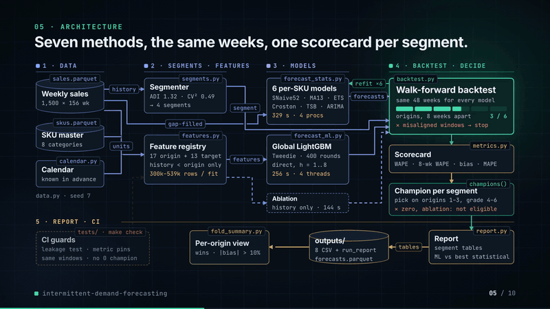

# intermittent-demand-forecasting

[](https://github.com/kavya2693/intermittent-demand-forecasting/actions/workflows/ci.yml)


Which forecasting method to run for which SKU, when nearly half the catalogue sells nothing in
most weeks: segment by demand pattern, backtest every method on the same windows, and report
where the machine-learning model does not win.

[](https://kavya2693.github.io/work-demos/intermittent-demand-forecasting.mp4)

*90-second silent walkthrough. [Play the full video](https://kavya2693.github.io/work-demos/intermittent-demand-forecasting.mp4) · [download the MP4, 7 MB](docs/demo/demo.mp4).*

📄 **Audit report:** every figure and assumption in the video, traced to its source — [PDF](docs/demo/AUDIT_REPORT.pdf) · [Word](docs/demo/AUDIT_REPORT.docx) · [Markdown](docs/demo/AUDIT_REPORT.md)

## At a glance

| | |
|---|---|
| **Problem** | One forecasting method run across 1,500 SKUs, where 829 are intermittent or lumpy and 670 sell in under half the weeks. MAPE skips the zero weeks and weekly WAPE rewards forecasting zero, so the scorecard can pick a model that stocks nothing. |
| **Approach** | Classify every SKU by ADI and CV² into four Syntetos–Boylan segments, run seven methods (seasonal naive, moving average, ETS, Croston, TSB, ARIMA, one global LightGBM) through the same six walk-forward origins, and pick each segment's model on eight-week WAPE chosen on origins 1–3 and graded on 4–6. |
| **Result** | Across the catalogue LightGBM cuts **eight-week WAPE to 21.9%** from 29.1% for seasonal naive (ARIMA 31.3%). Picked early and graded late, it cuts weekly WAPE against seasonal naive by **25.8% on smooth and 30.7% on erratic** SKUs. Weekly WAPE would have crowned a zero forecast on **829 of 1,500** SKUs. |
| **What didn't win** | On intermittent SKUs LightGBM beats ARIMA on only **45.6%** of SKUs and on **2 of 6** origins; with the calendar and promotion plan removed it loses to ARIMA, ETS and TSB there. On lumpy SKUs it under-forecasts (bias **-8.9%**, -15.7% on its worst origin). |

## Architecture

```mermaid
flowchart LR
    subgraph SRC["Sources"]
        GEN["Seeded generator<br/>scripts/generate_data.py<br/>data.py"]
        SALES[("data/sales.parquet<br/>SKU x week units, price, promo")]
        SKUS[("data/skus.parquet<br/>category, channel, launch")]
        CAL["Holiday calendar<br/>calendar.py"]
    end

    subgraph FEAT["Data and features"]
        LOAD["Loader<br/>data.load"]
        IMP["Gap fill for model inputs<br/>forecast_stats.impute"]
        PANEL["SKU x week panel<br/>features.Panel"]
        REG["Feature registry, 30 features<br/>features.py"]
        SEG["ADI / CV² segmentation<br/>segments.py"]
    end

    subgraph MOD["Models"]
        STATS["Per-SKU statistical models<br/>naive · MA · ETS · Croston · TSB · ARIMA<br/>forecast_stats.py"]
        ML["Global LightGBM<br/>Tweedie, direct 1-8 weeks<br/>forecast_ml.py"]
        ABL["History-only ablation<br/>forecast_ml.fit(history_only)"]
        ZERO["Zero forecast reference<br/>backtest.ZERO"]
    end

    subgraph DEC["Decision"]
        BT["Walk-forward backtest<br/>6 origins x 8 weeks<br/>backtest.run"]
        CHAMP["Champion per segment<br/>picked on origins 1-3, graded on 4-6<br/>backtest.champions"]
    end

    subgraph EVAL["Evaluation"]
        MET["WAPE · 8-week WAPE · MAPE + coverage · bias<br/>metrics.py"]
        GAP["LightGBM vs best statistical<br/>backtest.ml_vs_best_stat"]
        FOLD["Wins and bias per origin<br/>scripts/fold_summary.py"]
    end

    subgraph OUT["Outputs"]
        REP["Report writer<br/>report.py"]
        FILES[("outputs/<br/>run_report.md · *.csv · forecasts.parquet")]
    end

    GEN --> SALES & SKUS
    CAL --> GEN
    CAL --> PANEL
    SALES --> LOAD
    SKUS --> LOAD
    LOAD -->|"history before origin 1"| SEG
    LOAD -->|"sales"| IMP
    LOAD -->|"sales + SKU table"| PANEL
    IMP -->|"gap-free series"| STATS
    PANEL -->|"history up to origin"| REG
    REG -->|"origin + target-week features"| ML
    REG -->|"history features only"| ABL
    STATS -->|"yhat per SKU-week"| BT
    ML -->|"yhat = prediction x SKU level"| BT
    ABL -->|"yhat"| BT
    ZERO -->|"yhat = 0"| BT
    SEG -->|"segment per SKU"| BT
    BT -->|"forecasts + actuals"| MET
    MET -->|"8-week WAPE, origins 1-3"| CHAMP
    MET --> GAP
    BT --> FOLD
    CHAMP --> REP
    GAP --> REP
    MET --> REP
    REP --> FILES
    FOLD --> FILES
    SALES -.->|"feed-gap weeks filled with trailing 8-week mean"| IMP
    SALES -.->|"raw actuals, missing weeks skipped"| MET
    ZERO -.->|"scored as a reference, never selectable"| CHAMP
    ABL -.->|"excluded from selection"| CHAMP

    classDef data fill:#7fa8ff,stroke:#3d6fd9,color:#0b1020
    classDef model fill:#b9a2ff,stroke:#7a5fd6,color:#0b1020
    classDef decision fill:#3fd8a8,stroke:#1f9c76,color:#0b1020
    classDef evaluation fill:#f2c46d,stroke:#b8902f,color:#0b1020
    classDef risk fill:#ff8a73,stroke:#cc5640,color:#0b1020

    class GEN,SALES,SKUS,CAL,LOAD,IMP,PANEL,REG,SEG,REP,FILES data
    class STATS,ML model
    class ZERO,ABL risk
    class BT,CHAMP decision
    class MET,GAP,FOLD evaluation
```





Solid edges are the main data flow; dotted edges are the gap-handling and guard paths. Red
nodes are the two arms built to challenge the headline: the zero forecast that weekly WAPE
rewards, and LightGBM without the information the statistical models never see.

### Components

| Component | Responsibility | File |
|---|---|---|
| Data generator | 1,500 SKUs of weekly sales over 156 weeks, with seasonality, holidays, promotions, price steps, bulk orders, stock-outs, launches, phase-outs and feed gaps | [`scripts/generate_data.py`](scripts/generate_data.py), [`src/demand_segments/data.py`](src/demand_segments/data.py) |
| Calendar | Monday-labelled weeks and the Black Friday, Christmas, New Year, Easter and back-to-school flags | [`src/demand_segments/calendar.py`](src/demand_segments/calendar.py) |
| Segmentation | ADI and CV² on history before the first origin, Syntetos–Boylan cut-offs 1.32 and 0.49 | [`src/demand_segments/segments.py`](src/demand_segments/segments.py) |
| Feature registry | SKU x week panel; 17 origin features and 13 target-week features, each a function of history up to the origin | [`src/demand_segments/features.py`](src/demand_segments/features.py) |
| Statistical models | statsforecast cross-validation of seasonal naive (52), 13-week moving average, ETS, Croston, TSB and ARIMA, refitted at every origin | [`src/demand_segments/forecast_stats.py`](src/demand_segments/forecast_stats.py) |
| Global LightGBM | One model across all SKUs, direct 1–8 week horizon, target scaled by SKU level, Tweedie loss weighted by level; history-only variant for the ablation | [`src/demand_segments/forecast_ml.py`](src/demand_segments/forecast_ml.py) |
| Backtest | Same six eight-week windows for every model, zero-forecast reference, champion picked early and graded late, LightGBM vs best statistical per segment | [`src/demand_segments/backtest.py`](src/demand_segments/backtest.py) |
| Metrics | Weekly WAPE, eight-week WAPE, MAPE with coverage, bias; missing actuals never scored as zero | [`src/demand_segments/metrics.py`](src/demand_segments/metrics.py) |
| Report and orchestrator | One command end to end, then the CSV tables and `run_report.md` | [`src/demand_segments/cli.py`](src/demand_segments/cli.py), [`src/demand_segments/report.py`](src/demand_segments/report.py) |
| Origin summary | Per-origin wins on both WAPEs and the LightGBM bias range per segment | [`scripts/fold_summary.py`](scripts/fold_summary.py) |

### Design decisions

| Decision | Options considered | Chosen | Trade-off |
|---|---|---|---|
| Metric that picks the model | MAPE; weekly WAPE; WAPE on each SKU's eight-week total | Eight-week WAPE, with the other three reported alongside ([ADR-0001](docs/adr/0001-segment-then-compare-on-shared-windows.md)) | A zero forecast scores 100% and can never win, and the window matches a replenishment order; it does not reward getting the week of a sale right inside the window |
| How the catalogue is split | One method for every SKU; Syntetos–Boylan ADI / CV² segments | Four segments, fixed on history before the first origin | Results are readable per demand pattern, but the classes are noisy (125 of 448 SKUs built as smooth land in erratic) and SKUs that change pattern stay in their first segment |
| Selection and grading windows | Pick and score on all six origins; pick on 1–3, grade on 4–6 | Pick on 1–3, grade on 4–6 | The champion is not graded on the windows that chose it, at the cost of half the windows for each step |
| Shape of the ML model | LSTM; per-SKU models; global recursive LightGBM; global direct LightGBM | Global direct LightGBM with horizon as a feature | Slow movers borrow strength from the whole catalogue, no error compounds through fed-back lags, and the leakage test is simple to state; LSTM was not built |
| Target and loss | Raw units with squared error; units scaled by SKU level with a Tweedie loss weighted by level | Scaled target, Tweedie (power 1.3), level weights | One model serves SKUs selling 1 a month and 300 a week while the loss still counts units as WAPE does; the scale needs a floor for SKUs with no sales yet |
| Seasonality in the statistical models | Seasonal ETS or ARIMA at m=52; non-seasonal fits with seasonal naive carrying the year | Non-seasonal ETS and ARIMA | Six refits of 1,500 series stay at about twelve minutes, but the statistical side is weaker on seasonal smooth SKUs than a tuned seasonal model would be |

### Data contracts

| Stage | Input | Output |
|---|---|---|
| Generator to loader | `GeneratorConfig` (seed, SKUs, weeks, launch, phase-out and gap shares) | `sales.parquet`: `sku_id` (str), `week` (Monday date), `units` (float, NaN for a feed-gap week), `price` (float), `promo` (0/1); `skus.parquet`: `sku_id, category, channel` (B2B/B2C), `intended_pattern` (read only by the report's agreement check), `launch_week, phase_out_week` (int) |
| Segmentation | sales strictly before the first origin | `sku_segments.csv`: `sku_id, adi, cv2` (float), `segment` (smooth / erratic / intermittent / lumpy) |
| Statistical models | gap-filled `sku_id, week, units` | long frame `sku_id, week, cutoff, model, yhat` (float, clipped at zero) |
| Feature registry | `Panel` (SKU x week matrices of units, promo, price; calendar frame), origin index | one row per SKU x target week: 30 features, `sku_idx, t, scale, y`; training rows need 8+ observed weeks and an observed target |
| LightGBM | training frame with label `y / scale`, weight `scale` | `sku_idx, t, yhat` with `yhat = max(prediction, 0) x scale` |
| Backtest | sales, SKU table, number of origins | `forecasts.parquet`: `sku_id, week, fold, model, yhat, y, segment` |
| Scoring and report | forecasts | `scores_by_segment.csv` and `scores_by_fold.csv`: `segment, model, wape, wape_8wk, mape, mape_coverage, bias, actual_units, n`; `champions.csv`, `lightgbm_vs_best_statistical.csv`, `fold_summary.csv`, `feature_importance.csv`, `run_report.md` |

### Failure modes and fallbacks

| Failure | What the code does |
|---|---|
| Sales feed late or missing for some weeks (about 4% of SKUs have a 2–6 week outage) | Missing weeks stay NaN, never zero. The statistical models get them filled with the trailing eight-week mean; LightGBM features use NaN-aware statistics and training drops rows with no observed target; segmentation drops them from ADI and CV²; every metric skips them. |
| New SKU with little or no history | Weeks before launch are not in the data. Pre-launch prices are back-filled so price ratios exist; the SKU level falls back from the trailing 52-week mean to the full-history mean, then to a floor of 0.1; LightGBM trains only on SKUs with at least eight observed weeks. A SKU with no sale before the first origin gets an infinite ADI and lands in a slow segment. |
| A model leaves a hole where an actual exists | `metrics` raises rather than scoring the gap, so a model cannot look accurate by forecasting fewer weeks. |
| Statistical and ML windows drift apart | The backtest checks that the statsforecast cutoffs equal the backtest origins and stops with an error if they do not. |
| Negative forecasts | Clipped to zero for every model. |
| ARIMA too slow for the machine | `--jobs` spreads the statistical models over processes and `--no-arima` drops ARIMA; CI runs 120 SKUs without it. There is no per-model timeout. |
| Model degrades or SKUs change pattern | Not handled. Segments are fixed at the first origin, models are refitted each origin but not monitored for drift, and lumpy bias is not corrected; all three are in the limitations below. |
| LLM or model-server timeout | Not applicable: there is no LLM, model server or network call in the pipeline. |

### Path to production

This is a mapping of each local piece to what would replace it in a deployed system, not a
description of one that exists.

| Here | Production equivalent |
|---|---|
| Seeded generator writing parquet to `data/` | Weekly sales, price and promotion plan from the ERP and POS into a warehouse (BigQuery, Snowflake or Redshift), partitioned by week, with feed gaps kept as nulls |
| `make run` on a laptop | A weekly scheduled job in Airflow or Step Functions after the sales week closes |
| statsforecast over four local processes | statsforecast on Ray, Spark or Dask, or container batch jobs sharded by SKU (Cloud Run Jobs, AWS Batch) |
| LightGBM refitted at every origin in-process | Versioned models in a registry (MLflow, SageMaker or Vertex AI), retrained weekly and promoted only if they beat the incumbent on held-out eight-week WAPE per segment |
| Champion per segment written to `champions.csv` | A versioned champion table read by the forecasting job, re-picked on a fixed cadence on the latest early/late split |
| Segments fixed at the first origin | Re-segmentation on a rolling 52 weeks every run, with SKUs that switch segment logged |
| `outputs/*.csv` and `run_report.md` | A forecast table in the warehouse feeding replenishment, plus a planner dashboard per segment |
| Monitoring (not built) | Eight-week WAPE and bias per segment at each origin once actuals land; an alert when a segment's bias leaves ±10% (lumpy already does on two origins); segment migration counts; share of feed-gap weeks; drift on promotion and price inputs |

## The problem

A demand planner with 1,500 SKUs runs one forecasting method across the whole catalogue
because there is no time to tune 1,500 series. Half of that catalogue is not the kind of
series the method was built for. Floor cleaner sells 40 units every week; a replacement pump
seal sells two units in March, nothing until July, then six. A forecast that works for the
first produces nonsense for the second, and the planner finds out when the seal is out of
stock for a trade customer or when a pallet of it has sat in the warehouse for a year.

The usual scorecards make this worse. MAPE cannot be computed in a week with zero sales, so
it quietly scores only the weeks where something sold. Weekly WAPE is defined, but on a SKU
whose typical week has no sale, the forecast that minimises it is zero, which is the one
forecast nobody can replenish from. A team can pick a model on these numbers and ship
something that looks accurate and stocks nothing.

## The approach

Each SKU is classified by ADI (average weeks between sales) and CV² (variability of the sale
sizes) into the four Syntetos–Boylan segments: smooth, erratic, intermittent, lumpy. Every
method then forecasts the same eight-week windows from six walk-forward origins over the last
48 weeks: seasonal naive (the baseline), a 13-week moving average, ETS, Croston, TSB, ARIMA,
and one global LightGBM model trained across all SKUs on features built automatically from a
registry. Results are reported per segment on four measures: weekly WAPE, WAPE on each SKU's
eight-week total, MAPE with the share of weeks it actually covers, and bias.

The key decision was to choose each segment's model on eight-week WAPE, picked on the first
three origins and graded on the last three. Eight weeks is roughly what a replenishment order
has to cover, and on that measure a zero forecast scores 100%, so it can never win. On weekly
WAPE it beats every model on the intermittent and lumpy segments.

## The result

1,500 SKUs, 156 weeks, six origins, 8-week horizon (`outputs/run_report.md`). Lower WAPE is
better; bias is total forecast over total actual, minus one.

| Segment (SKUs) | Model | Weekly WAPE | 8-week WAPE | MAPE (weeks covered) | Bias |
|---|---|---|---|---|---|
| smooth (325) | seasonal naive | 36.8% | 19.4% | 67.6% (99%) | -3.0% |
| | best statistical: ARIMA | 35.5% | 25.0% | 61.1% | -1.2% |
| | LightGBM | **27.1%** | **15.2%** | 50.5% | -1.2% |
| erratic (346) | seasonal naive | 73.6% | 35.5% | 176.1% (95%) | +1.3% |
| | best statistical: ARIMA | 58.5% | 34.8% | 164.2% | +1.0% |
| | LightGBM | **51.4%** | **25.6%** | 138.3% | -4.0% |
| intermittent (397) | seasonal naive | 133.4% | 64.2% | 82.1% (35%) | -6.5% |
| | best statistical: ARIMA | 121.9% | 55.1% | 55.1% | -4.2% |
| | LightGBM | 121.1% | **51.4%** | 52.9% | +0.5% |
| | zero forecast | **100.0%** | 100.0% | 100.0% | -100.0% |
| lumpy (432) | seasonal naive | 156.8% | 80.3% | 123.4% (34%) | -1.5% |
| | best statistical: TSB | 136.2% | 72.3% | 76.9% | 0.0% |
| | LightGBM | 129.0% | **63.6%** | 70.4% | -8.9% |
| | zero forecast | **100.0%** | 100.0% | 100.0% | -100.0% |
| all | seasonal naive | 58.1% | 29.1% | 116.7% (62%) | -1.3% |
| all | ARIMA (best statistical overall) | 50.2% | 31.3% | 98.4% | -0.3% |
| all | LightGBM | **42.5%** | **21.9%** | 84.9% | -2.7% |

Champion picked on origins 1–3, scored on origins 4–6 (`outputs/champions.csv`): LightGBM was
picked in all four segments, and cut weekly WAPE against seasonal naive by 25.8% (smooth),
30.7% (erratic), 8.5% (intermittent) and 17.8% (lumpy).

**Where the ML model does not win.** On intermittent SKUs LightGBM is 0.8 points of weekly
WAPE better than ARIMA in aggregate, but it beats ARIMA on only 45.6% of those SKUs
individually, and on only 2 of the 6 origins (`outputs/lightgbm_vs_best_statistical.csv`,
`outputs/fold_summary.csv`). Its intermittent margin exists only on the eight-week total. On
lumpy SKUs it under-forecasts: bias is -8.9% across all origins and worse than -10% on two of
six origins (-15.7% at its worst), so the ±10% bias line is not held there.

**The experiment that could have embarrassed the result.** The statistical models see only
sales history; LightGBM also sees the calendar, the promotion plan and price. Refitting
LightGBM with those inputs removed (`LightGBM-history-only`) raises total weekly WAPE from
42.5% to 45.1%, and on the intermittent segment it then loses to ARIMA, ETS and TSB
(122.9% against 121.9%, 122.2% and 122.8%). It
still beats every statistical model on smooth, erratic and lumpy SKUs. So about a sixth of the
margin over seasonal naive is information the statistical models never had, and on
intermittent SKUs it is the whole weekly-WAPE margin (on the eight-week total the
history-only model still beats ARIMA, 53.7% vs 55.1%).

**The segmentation is noisier than the textbook picture.** The generator gives each SKU an
intended pattern and the classifier never sees it. 125 of 448 SKUs built as smooth are
classified erratic, because strong seasonality inflates CV² of the sale sizes, and 145 of 525
built as intermittent land in lumpy because of occasional bulk orders
(`outputs/segment_vs_generator_intent.csv`).

**The two WAPEs disagree on smooth SKUs too.** ARIMA beats seasonal naive week by week
(35.5% vs 36.8%) but loses on the eight-week total (25.0% vs 19.4%): without a yearly season
it misses the level of the coming two months even when its weekly shape is closer.

## How it works

```
data/sales.parquet ──► segments.py   ADI / CV² on history before the first origin ─► segment per SKU
        │
        ├────────────► forecast_stats.py   statsforecast cross-validation, refit at each origin
        │                 seasonal naive(52) · moving average(13) · ETS · Croston · TSB · ARIMA
        │
        └─► features.py  registry of origin features (levels, zero share, weeks since sale, CV²)
                         and target-week features (calendar, promotion plan, price, sales a year ago)
                 │
                 └─► forecast_ml.py   one LightGBM over all SKUs, direct 1–8 week horizon,
                                      target = sales / SKU level, Tweedie loss weighted by level
        ▼
backtest.py   same six origins for every model ─► metrics.py (WAPE, 8-week WAPE, MAPE + coverage, bias)
        ▼
report.py     per segment tables, champion picked early and scored late, LightGBM vs best statistical
```

The global model trains on every past origin whose eight target weeks end before the forecast
origin, stepping two weeks at a time, so at the first origin it has about 1,500 × 25 × 8 rows.
Feature functions only receive the history up to the origin; the calendar, promotion plan and
price for the target week are allowed because a planner has them in advance. Design decisions
and rejected alternatives (LSTM, seasonal ETS at m=52, recursive forecasting, weekly-WAPE
selection) are in [docs/adr/0001-segment-then-compare-on-shared-windows.md](docs/adr/0001-segment-then-compare-on-shared-windows.md).

## Running it

```bash
uv sync
make run      # 1,500 SKUs, six origins, every model, plus the history-only ablation (about 12 min)
make quick    # 120 SKUs, same pipeline, about a minute
make check    # ruff, format, mypy, pytest
docker build -t demand-segments . && docker run --rm demand-segments
```

`make data` writes the dataset alone. Tables land in `outputs/`: `scores_by_segment.csv`,
`scores_by_fold.csv`, `champions.csv`, `lightgbm_vs_best_statistical.csv`, `fold_summary.csv`,
`feature_importance.csv`, `sku_segments.csv` and `run_report.md`. Nothing needs an API key or
a model server.

## The data

The dataset is generated by the seeded script `scripts/generate_data.py` (`make data`) and is
sized to the production problem, 1,500 SKUs of weekly sales over three years; the production
data it stands in for is proprietary. It mixes trade (B2B) and retail (B2C) channels across
eight categories, with category-specific yearly seasonality, Black Friday, Christmas, Easter
and back-to-school effects, planned promotions with a post-promotion dip, step price
increases, bulk-order outliers, stock-out weeks that censor sales, product launches partway
through the history, a few SKUs being phased out, and short feed gaps recorded as missing
rather than zero. Its limit is that the patterns are the ones written into the generator:
real catalogues have substitution between SKUs, promotions that are not on the plan, and
demand shifts the generator does not produce.

## Tests

`tests/test_features.py` rewrites every sale on or after the forecast origin with random
numbers and checks that no feature changes, then proves the check has teeth by registering a
feature that peeks one week ahead and confirming it is caught. Any feature added to the
registry is covered automatically.

`tests/test_metrics.py` pins the measures to hand-worked numbers: missing weeks are skipped
rather than scored as zero sales, bias and WAPE disagree when errors cancel, MAPE reports how
few weeks it covers, and on a SKU selling four units every four weeks weekly WAPE prefers a
zero forecast while eight-week WAPE scores the steady forecast as perfect.
`tests/test_backtest.py` checks that every model forecasts exactly the same SKU-weeks over
non-overlapping windows and that neither the zero forecast nor the ablation can be picked as
a champion.

## Known limitations

- **The biggest gap: point forecasts only.** Replenishment for intermittent SKUs needs a
  quantile or a demand distribution over lead time; no service-level or inventory simulation
  is done, so the comparison is on error, not on fill rate or stock held.
- ETS and ARIMA are fitted without a 52-week season; only seasonal naive and LightGBM carry
  the yearly pattern, so the statistical side is weaker on seasonal smooth SKUs than a tuned
  seasonal model would be.
- LightGBM under-forecasts lumpy SKUs (bias -8.9%, -15.7% on its worst origin). A bias
  correction per segment was not tried.
- Segments are fixed at the first origin. SKUs that change pattern during the year are scored
  in their original segment.
- LSTM from the original brief was not built; see the ADR.
- The data is generated, so the numbers show the method behaving as expected on realistic
  patterns, not a measured business impact.

## Insights and learning

I picked this problem because the hardest SKUs in a forecasting portfolio are the ones that
almost never sell, and the metrics most teams report are least trustworthy exactly there. I
expected the interesting result to be which model wins on intermittent demand. The more
useful result was that the scorecard itself picks the wrong answer: weekly WAPE crowns a
forecast of zero on 829 of the 1,500 SKUs. Moving model selection to the eight-week total was
a bigger change than any model choice.

What surprised me was how much of the ML margin is information rather than algorithm. Taking
the calendar and promotion plan away from LightGBM costs it about a sixth of its gain over
seasonal naive, and its whole weekly-WAPE edge on intermittent SKUs. If I were presenting this to a
planning team, the honest message is that LightGBM is worth running for smooth and erratic
SKUs, while for intermittent SKUs ARIMA and ETS are level with it week by week and the case for
LightGBM rests on a four-point lead on the eight-week total (51.4% vs 55.1%), which is a smaller and cheaper
thing to replace with a tuned statistical model.

What I got wrong first: I sized the run for a dedicated CPU, and the first full run with
ARIMA starved on a shared machine and had to be stopped; it now runs the statistical models
across four worker processes. Next
I would add quantile forecasts and a lead-time inventory simulation, so the comparison is on
fill rate and stock held rather than on error alone, and try a per-segment bias correction
for lumpy SKUs.

## License

MIT
