# intermittent-demand-forecasting: demo video audit report

**Repository:** https://github.com/kavya2693/intermittent-demand-forecasting  
**Numbers taken from commit:** `3616b6c` (outputs last changed in `3616b6c (2026-10-13 22:03:11 +0400)`)  
**Video:** `docs/demo/demo.mp4` (88.4 s, 1920x1080, 30 fps, silent)  
**Generated:** 2026-10-14 14:20  
**Automated checks:** 63 pass · 0 fail · 1 manual (of 64 figures)

## How to use this report

Every number or claim on screen has an ID (`F-01`, `F-02`, ...) and every modelling assumption has an ID (`A-01`, ...). Cite the ID. Each figure lists its source file, the exact column/row/key, the formula for derived numbers, and an automated check result. The change-impact matrix tells you which slides and files change if an input or assumption changes.

Types: **direct** = read straight from a repo output; **derived** = computed from direct values (formula given); **illustrative** = drawing or example, not data; **general knowledge** = context not produced by the repo.

### Regenerate

```bash
make run                                   # outputs/*.csv, run_report.md, forecasts.parquet (~12 min)
PYTHONPATH=src .venv/bin/python docs/demo/source/tools/export_forecast_sheet.py docs/demo/source/assets/forecast_sheet.json
python3 docs/demo/source/tools/inject_sheet.py docs/demo/source/assets/forecast_sheet.json docs/demo/source/compositions/value.html --block SHEET --keys origin_week,window_end_week,skus,model,wape_8wk_all,forecast_units_8wk,sold_units_8wk,rows
python3 docs/demo/source/tools/inject_sheet.py docs/demo/source/assets/forecast_sheet.json docs/demo/source/compositions/s04-routes.html --block RUN --keys scatter,example,forecast_rows_total,forecast_models
python3 docs/demo/source/tools/make_end_scatter.py outputs/sku_segments.csv docs/demo/source/assets/scatter-end.png
cd docs/demo/source && npx --yes hyperframes@0.8.156 check && npx --yes hyperframes@0.8.156 render -f 30 -q looks -o renders/intermittent-demand-forecasting-master.mp4 && cd -
ffmpeg -y -i docs/demo/source/renders/intermittent-demand-forecasting-master.mp4 -c:v libx264 -preset slow -crf 25 -pix_fmt yuv420p -movflags +faststart -an docs/demo/demo.mp4
python3 docs/demo/source/tools/build_audit_report.py docs/demo/source/audit/facts.yaml   # stills, checks, MD/DOCX/PDF
```

## 1. Figures

| ID | Shown on screen | Slides | Source | Column / row / key | How computed | Type | Check |
|---|---|---|---|---|---|---|---|
| F-01 | 3 industry chips | 01 | `author's framing` | - | - | general knowledge | manual: Context statement, not a repo output. |
| F-02 | 4 problem cards | 01 | `README 'The problem'` | README lines 14-28 | - | general knowledge | ✓ verified |
| F-03 | 1,500 SKUs | 02, 05, 06, 07, 08 | `outputs/sku_segments.csv` | row count | - | direct | ✓ verified |
| F-04 | 156 weeks / 1,500 × 156 wk | 02, 05 | `outputs/run_log.txt (printed by cli.py from data/sales.parquet)` | '1500 SKUs, 156 weeks' | - | direct | ✓ verified |
| F-05 | 670 are slow movers | 02 | `outputs/sku_segments.csv` | adi | count(adi > 2) = 670 | derived | ✓ verified |
| F-06 | slow = sells in < half the weeks | 02 | `src/demand_segments/segments.py:26 (adi = len(h) / len(nz))` | ADI = observed weeks / weeks with a sale | ADI > 2 <=> sale weeks < half of observed weeks | direct | ✓ verified |
| F-07 | 7 methods, same windows / Seven methods | 02, 05 | `outputs/forecasts.parquet (model column)` | models minus ZeroForecast and LightGBM-history-only | 9 - 2 = 7 | direct | ✓ verified |
| F-08 | weekly WAPE crowns zero: 829 SKUs | 02, 04 | `outputs/segment_counts.csv; outputs/scores_by_segment.csv` | skus where segment in {intermittent, lumpy} | 397 + 432 = 829 | derived | ✓ verified |
| F-09 | crowns zero / zero beats every model | 02, 04 | `outputs/scores_by_segment.csv` | argmin(wape) per segment | segments whose best weekly WAPE is ZeroForecast = {intermittent, lumpy} | derived | ✓ verified |
| F-10 | method per type · 8-week totals · losses shown | 03 | `outputs/champions.csv; outputs/scores_by_segment.csv (wape_8wk); outputs/lightgbm_vs_best_statistical.csv` | 4 champion rows; wape_8wk column; win share < 50% on intermittent | - | direct | ✓ verified |
| F-11 | REPLAY THE PAST · step forward, repeat · refit ×6 | 03, 05 | `src/demand_segments/backtest.py:29-31; forecast_stats.py:49-57` | origins(); cross_validation(step_size=HORIZON) | - | direct | ✓ verified |
| F-12 | SOLD 0 0 0 4 0 0 0 4 · ZERO · STEADY · winners | 04 | `tests/test_metrics.py:70-80 (test_eight_week_wape_stops_rewarding_the_zero_forecast)` | y = tile([0,0,0,4], 2) | weekly WAPE: steady 12/8 = 150% > zero 100%; 8-week WAPE: steady 0%, zero 100% | illustrative | ✓ verified |
| F-14 | sales.parquet, skus.parquet, calendar.py, data.py, segments.py, features.py, forecast_stats.py, forecast_ml.py, backtest.py, metrics.py, champions(), report.py, fold_summary.py, tests/ · make check | 05 | `src/demand_segments/, scripts/, tests/, Makefile` | files + defs | - | direct | ✓ verified |
| F-16 | 8 categories | 05 | `src/demand_segments/data.py:20-29 (CATEGORIES)` | dict entries | - | direct | ✓ verified |
| F-17 | data.py · seed 7 | 05 | `src/demand_segments/data.py:39` | seed: int = 7 | - | direct | ✓ verified |
| F-18 | ADI 1.32 · CV² 0.49 | 05, 06 | `src/demand_segments/segments.py:14-15` | ADI_CUT, CV2_CUT | - | direct | ✓ verified |
| F-19 | 17 origin + 13 target | 05 | `src/demand_segments/features.py (ORIGIN_FEATURES, TARGET_FEATURES) via demo assets/forecast_sheet.json arch` | len(ORIGIN_FEATURES), len(TARGET_FEATURES) | - | direct | ✓ verified |
| F-20 | 300k–539k rows / fit | 05 | `features.training_frame(panel, origin) via demo assets/forecast_sheet.json arch` | train_rows_first_origin = 299,648; train_rows_last_origin = 539,390 | rounded to thousands | derived | ✓ verified |
| F-21 | SNaive52 · MA13 · ETS · Croston · TSB · ARIMA | 05 | `src/demand_segments/forecast_stats.py:25-33` | models() | - | direct | ✓ verified |
| F-22 | 329 s · 4 procs | 05 | `outputs/run_report.md; Makefile:8` | 'statistical models: 329'; --jobs 4 | - | direct | ✓ verified |
| F-23 | Tweedie · 400 rounds · direct, h = 1..8 · 256 s · 4 threads | 05 | `src/demand_segments/forecast_ml.py:14, :25, :27; features.py:21; outputs/run_report.md` | objective, num_threads, ROUNDS, HORIZON, 'LightGBM: 256' | - | direct | ✓ verified |
| F-24 | Ablation · history only · 144 s | 05 | `outputs/run_report.md` | 'LightGBM-history-only: 144' | - | direct | ✓ verified |
| F-25 | same 48 weeks for every model · origins, 8 weeks apart · 6 / 6 | 05, 06 | `outputs/forecasts.parquet` | distinct weeks; 6 folds | 6 × 8 = 48 | direct | ✓ verified |
| F-26 | ✕ misaligned windows → stop | 05 | `src/demand_segments/backtest.py:56-59` | RuntimeError | - | direct | ✓ verified |
| F-27 | WAPE · 8-wk WAPE · bias · MAPE | 05 | `src/demand_segments/metrics.py` | wape, window_wape, bias, mape | - | direct | ✓ verified |
| F-28 | pick on origins 1–3, grade 4–6 | 05, 08 | `src/demand_segments/report.py:30; backtest.py:109` | n_select = n_windows // 2 = 3 | - | direct | ✓ verified |
| F-29 | ✕ zero, ablation: not eligible | 05 | `src/demand_segments/backtest.py:108; tests/test_backtest.py:41` | isin([ZERO, ML_HISTORY_ONLY]) | - | direct | ✓ verified |
| F-30 | 8 CSV + run_report | 05 | `src/demand_segments/report.py:41-48` | .to_csv calls | - | direct | ✓ verified |
| F-31 | wins · \|bias\| > 10% | 05 | `scripts/fold_summary.py` | origins_with_abs_bias_over_10pct | - | direct | ✓ verified |
| F-32 | CI guards · leakage test · metric pins · same windows · no 0 champion | 05 | `tests/*.py; .github/workflows/ci.yml; Makefile check` | test names | - | direct | ✓ verified |
| F-33 | make run ≈ 12 min / ~12 min | 05, 10 | `outputs/run_report.md 'Run time (seconds)'` | 329 + 256 + 144 = 729 s | 729 / 60 = 12.2 min | derived | ✓ verified |
| F-34 | batch, offline · no API key or model server | 05 | `README 'Running it'` | 'Nothing needs an API key or a model server' | - | direct | ✓ verified |
| F-35 | champion path: LightGBM won all 4 segments | 05 | `outputs/champions.csv` | champion | count(champion == LightGBM) | direct | ✓ verified |
| F-36 | refit ×6 | 05 | `src/demand_segments/backtest.py:68-71 (fit per origin); forecast_stats.py:49-57 (cross_validation n_windows)` | for fold, origin in enumerate(starts) | - | direct | ✓ verified |
| F-37 | 325 / 346 / 397 / 432 | 06 | `outputs/segment_counts.csv` | skus | - | direct | ✓ verified |
| F-38 | 1,500 dots on the ADI / CV² plane | 06 | `outputs/sku_segments.csv; RUN block in compositions/s04-routes.html` | adi, cv2, segment (rounded to 3 decimals) | - | direct | ✓ verified |
| F-39 | 3.9/3 · 3.7/3 · 3.6/4 · 3.2/1 · 4.0/1 · 2.9/5 | 06 | `outputs/forecasts.parquet` | sku_id = SKU00191, model = LightGBM, sum(yhat), sum(y) per fold | sums per fold, forecast rounded to 0.1 | derived | ✓ verified |
| F-40 | about 0.4 a week | 06 | `outputs/forecasts.parquet` | SKU00191, LightGBM, mean(yhat) over 48 weeks = 0.44 | - | derived | ✓ verified |
| F-41 | 9 models × 1,500 SKUs × 48 weeks = 648,000 forecasts | 06 | `outputs/forecasts.parquet` | row count | 9 × 1,500 × 48 | direct | ✓ verified |
| F-42 | One spare part | 06 | `outputs/sku_segments.csv; data/skus.parquet` | SKU00191 | - | direct | ✓ verified |
| F-43 | SKU01050, SKU01018, SKU00191, SKU00029, SKU01486, SKU00330 | 07 | `outputs/forecasts.parquet (fold 6, LightGBM); outputs/sku_segments.csv; data/skus.parquet; data/sales.parquet; SHEET block in compositions/value.html` | per-SKU sums | recomputed from the repo files, compared to the injected SHEET | direct | ✓ verified |
| F-44 | + 1,494 more SKUs on this sheet | 07 | `F-03` | 1,500 - 6 rows | 1,500 - 6 = 1,494 | derived | ✓ verified |
| F-45 | 215,538 forecast vs 222,039 sold | 07 | `outputs/forecasts.parquet` | fold 6, LightGBM: sum(yhat), sum(y) | - | derived | ✓ verified |
| F-46 | 8-week WAPE 20.7% | 07 | `outputs/forecasts.parquet` | fold 6, LightGBM | sum \|8-wk forecast - 8-wk sold\| / sum 8-wk sold over SKUs (metrics.window_wape) | derived | ✓ verified |
| F-47 | FROM 2025-11-03 · LightGBM | 07 | `outputs/forecasts.parquet` | first week of fold 6 | - | direct | ✓ verified |
| F-50 | 21.9% | 08 | `outputs/scores_by_segment.csv` | segment=all, model=LightGBM, wape_8wk | x 100 | direct | ✓ verified |
| F-51 | seasonal naive 29.1% | 08 | `outputs/scores_by_segment.csv` | segment=all, model=SeasonalNaive, wape_8wk | x 100 | direct | ✓ verified |
| F-52 | -25.8% | 08 | `outputs/champions.csv` | segment=smooth, wape_reduction_vs_seasonal_naive | -(x 100) | direct | ✓ verified |
| F-53 | 37.6% → 27.9% | 08 | `outputs/champions.csv` | seasonal_naive_wape, champion_wape | - | direct | ✓ verified |
| F-54 | -30.7% | 08 | `outputs/champions.csv` | segment=erratic, wape_reduction_vs_seasonal_naive | -(x 100) | direct | ✓ verified |
| F-55 | 74.8% → 51.9% | 08 | `outputs/champions.csv` | seasonal_naive_wape, champion_wape | - | direct | ✓ verified |
| F-56 | 24/24 · 4 segments × 6 origins | 08 | `outputs/fold_summary.csv` | sum(origins_won_on_wape_8wk), sum(origins) | - | direct | ✓ verified |
| F-57 | LightGBM wins all four segments on the 8-week total. | 08 | `outputs/scores_by_segment.csv` | argmin(wape_8wk) excluding ZeroForecast and the ablation | - | derived | ✓ verified |
| F-58 | 100.0% | 09 | `outputs/scores_by_segment.csv` | segment=intermittent, model=ZeroForecast, wape | x 100 | direct | ✓ verified |
| F-59 | 121.1% | 09 | `outputs/scores_by_segment.csv` | segment=intermittent, model=LightGBM, wape | x 100 | direct | ✓ verified |
| F-60 | 121.9% | 09 | `outputs/scores_by_segment.csv; outputs/lightgbm_vs_best_statistical.csv` | segment=intermittent, model=AutoARIMA, wape; best_statistical = AutoARIMA | x 100 | direct | ✓ verified |
| F-61 | 122.9% | 09 | `outputs/scores_by_segment.csv` | segment=intermittent, model=LightGBM-history-only, wape | x 100 | direct | ✓ verified |
| F-62 | 397 SKUs | 09 | `outputs/segment_counts.csv` | segment=intermittent | - | direct | ✓ verified |
| F-63 | 45.6% | 09 | `outputs/lightgbm_vs_best_statistical.csv` | segment=intermittent, lightgbm_sku_win_share | x 100 | direct | ✓ verified |
| F-64 | 2 of 6 origins | 09 | `outputs/fold_summary.csv` | segment=intermittent, origins_won_on_wape / origins | - | direct | ✓ verified |
| F-65 | the edge is the calendar and promo plan, not the algorithm | 09 | `outputs/scores_by_segment.csv` | intermittent: LightGBM-history-only 122.9% > AutoARIMA 121.9% > LightGBM 121.1% | - | derived | ✓ verified |
| F-66 | MIT | 10 | `LICENSE line 1` | - | - | direct | ✓ verified |
| F-67 | $ make run   # 1,500 SKUs, 6 origins, ~12 min | 10 | `Makefile:7-9; README 'Running it'` | run target | - | direct | ✓ verified |
| F-68 | LightGBM · statsforecast · pandas · Python | 10 | `pyproject.toml dependencies` | lightgbm, statsforecast, pandas | - | direct | ✓ verified |

## 2. Automated check run (2026-10-14 14:20)

| ID | Expected on slide | Recomputed from repo | Result |
|---|---|---|---|
| F-01 | 3 industry chips | - | manual |
| F-02 | true | true | ✓ pass |
| F-03 | 1,500 | 1,500 | ✓ pass |
| F-04 | true | true | ✓ pass |
| F-05 | 670 | 670 | ✓ pass |
| F-06 | true | true | ✓ pass |
| F-07 | 7 | 7 | ✓ pass |
| F-08 | 829 | 829 | ✓ pass |
| F-09 | true | true | ✓ pass |
| F-10 | true | true | ✓ pass |
| F-11 | true | true | ✓ pass |
| F-12 | true | true | ✓ pass |
| F-14 | true | true | ✓ pass |
| F-16 | 8 | 8 | ✓ pass |
| F-17 | true | true | ✓ pass |
| F-18 | true | true | ✓ pass |
| F-19 | 17 origin + 13 target | 17 origin + 13 target | ✓ pass |
| F-20 | 300k–539k | 300k–539k | ✓ pass |
| F-21 | true | true | ✓ pass |
| F-22 | true | true | ✓ pass |
| F-23 | true | true | ✓ pass |
| F-24 | true | true | ✓ pass |
| F-25 | true | true | ✓ pass |
| F-26 | true | true | ✓ pass |
| F-27 | true | true | ✓ pass |
| F-28 | true | true | ✓ pass |
| F-29 | true | true | ✓ pass |
| F-30 | 8 | 8 | ✓ pass |
| F-31 | true | true | ✓ pass |
| F-32 | true | true | ✓ pass |
| F-33 | ~12 min | ~12 min | ✓ pass |
| F-34 | true | true | ✓ pass |
| F-35 | 4 | 4 | ✓ pass |
| F-36 | true | true | ✓ pass |
| F-37 | 325/346/397/432 | 325/346/397/432 | ✓ pass |
| F-38 | true | true | ✓ pass |
| F-39 | 3.9/3 · 3.7/3 · 3.6/4 · 3.2/1 · 4.0/1 · 2.9/5 | 3.9/3 · 3.7/3 · 3.6/4 · 3.2/1 · 4.0/1 · 2.9/5 | ✓ pass |
| F-40 | 0.4 | 0.4 | ✓ pass |
| F-41 | 648,000 | 648,000 | ✓ pass |
| F-42 | true | true | ✓ pass |
| F-43 | true | true | ✓ pass |
| F-44 | 1,494 | 1,494 | ✓ pass |
| F-45 | 215,538 forecast vs 222,039 sold | 215,538 forecast vs 222,039 sold | ✓ pass |
| F-46 | 20.7% | 20.7% | ✓ pass |
| F-47 | 2025-11-03 | 2025-11-03 | ✓ pass |
| F-50 | 21.9% | 21.9% | ✓ pass |
| F-51 | 29.1% | 29.1% | ✓ pass |
| F-52 | -25.8% | -25.8% | ✓ pass |
| F-53 | 37.6% → 27.9% | 37.6% → 27.9% | ✓ pass |
| F-54 | -30.7% | -30.7% | ✓ pass |
| F-55 | 74.8% → 51.9% | 74.8% → 51.9% | ✓ pass |
| F-56 | 24/24 | 24/24 | ✓ pass |
| F-57 | true | true | ✓ pass |
| F-58 | 100.0% | 100.0% | ✓ pass |
| F-59 | 121.1% | 121.1% | ✓ pass |
| F-60 | true | true | ✓ pass |
| F-61 | 122.9% | 122.9% | ✓ pass |
| F-62 | 397 | 397 | ✓ pass |
| F-63 | 45.6% | 45.6% | ✓ pass |
| F-64 | 2 of 6 | 2 of 6 | ✓ pass |
| F-65 | true | true | ✓ pass |
| F-66 | true | true | ✓ pass |
| F-67 | true | true | ✓ pass |
| F-68 | true | true | ✓ pass |

## 3. Assumptions register

| ID | Assumption | Source | Used by | Sensitivity: if this changes |
|---|---|---|---|---|
| A-01 | All data is synthetic, produced by a seeded generator sized to the production problem: 1,500 SKUs, 156 weekly periods, 8 categories, B2B and B2C channels, seed 7. The production data it stands in for is proprietary; the patterns are the ones written into the generator. | `src/demand_segments/data.py:20-29 (CATEGORIES), :37-39 (GeneratorConfig n_skus=1500, n_weeks=156, seed=7); README 'The data'` | all figures | figures all figures and slides 01, 02, 03, 04, 05, 06, 07, 08, 09, 10 change |
| A-02 | Segments use the Syntetos-Boylan cut-offs ADI 1.32 and CV² 0.49, computed on the history before the first origin, and stay fixed for all six origins. | `src/demand_segments/segments.py:14-15; src/demand_segments/backtest.py:51` | F-05, F-06, F-08, F-09, F-18, F-37, F-38, F-62 | figures F-05, F-06, F-08, F-09, F-18, F-37, F-38, F-62 and slides 02, 04, 05, 06, 09 change |
| A-03 | Walk-forward backtest: six origins, eight weeks apart, each forecasting the next eight weeks (48 test weeks), the same windows for every model. | `src/demand_segments/cli.py:18 (--windows default 6); features.py:21 (HORIZON = 8); backtest.py:29-31 (origins)` | F-07, F-11, F-25, F-36, F-39, F-41, F-56, F-64 | figures F-07, F-11, F-25, F-36, F-39, F-41, F-56, F-64 and slides 02, 03, 05, 06, 08, 09 change |
| A-04 | Each segment's champion is picked on eight-week WAPE over origins 1-3 and graded on origins 4-6; the zero forecast and the history-only ablation are never eligible. | `src/demand_segments/report.py:30 (n_select = n_windows // 2); backtest.py:100-130 (champions), :108` | F-10, F-28, F-29, F-35, F-52, F-53, F-54, F-55 | figures F-10, F-28, F-29, F-35, F-52, F-53, F-54, F-55 and slides 03, 05, 08 change |
| A-05 | ETS and ARIMA are fitted without a 52-week season (season_length=1); only seasonal naive and LightGBM carry the yearly pattern, so the statistical side is weaker on seasonal SKUs than a tuned seasonal model would be. | `src/demand_segments/forecast_stats.py:22-33; README 'Known limitations'` | F-21, F-53, F-55, F-58, F-59, F-60, F-61, F-63, F-64 | figures F-21, F-53, F-55, F-58, F-59, F-60, F-61, F-63, F-64 and slides 05, 08, 09 change |
| A-06 | LightGBM settings: Tweedie objective (variance power 1.3), 400 rounds, 63 leaves, seed 7, 4 threads; one global model, direct 1-8 week horizon, target = sales / SKU level. | `src/demand_segments/forecast_ml.py:11-27` | F-23, F-50, F-52, F-54, F-56, F-57, F-59 | figures F-23, F-50, F-52, F-54, F-56, F-57, F-59 and slides 05, 08, 09 change |
| A-07 | LightGBM may read the calendar, the promotion plan and the price list for the target week (11 'known-future' features), because a planner has them in advance. The per-SKU statistical models see sales history only. | `src/demand_segments/features.py:1-9 (docstring), forecast_ml.py:30-42 (KNOWN_FUTURE)` | F-24, F-61, F-65 | figures F-24, F-61, F-65 and slides 05, 09 change |
| A-08 | Feed-gap weeks are filled with a trailing 8-week mean for the statistical models' inputs only; every score uses the raw actuals, and missing actual weeks are skipped, never scored as zero. | `src/demand_segments/forecast_stats.py:37-46 (impute); metrics.py:9-14 (_clean)` | F-41, F-45, F-46 | figures F-41, F-45, F-46 and slides 06, 07 change |
| A-09 | Run times are wall-clock seconds from one make run on the author's laptop with --jobs 4 (statistical models) and 4 LightGBM threads; they change with the machine and its load. | `outputs/run_report.md 'Run time (seconds)'; Makefile:8 (--jobs 4); README 'What I got wrong first'` | F-22, F-23, F-24, F-33, F-67 | figures F-22, F-23, F-24, F-33, F-67 and slides 05, 10 change |
| A-10 | Slide 07 shows the LAST backtest origin (2025-11-03, weeks to 2025-12-22) as if it were the planner's sheet, with what actually sold next to it. Rows are the SKU at the median 8-week absolute % error of each segment (plus the next one in the two slow segments), not the best cases. The stock-room drain is forecast total minus weekly actual sales, an illustration, not an inventory simulation (README: point forecasts only). | `docs/demo/source/tools/export_forecast_sheet.py (row selection); README 'Known limitations'` | F-43, F-44, F-45, F-46, F-47 | figures F-43, F-44, F-45, F-46, F-47 and slides 07 change |
| A-11 | Video rounding: percentages to 1 decimal, units and counts to whole numbers with thousands separators, 8-week totals under 100 units to 1 decimal; '300k-539k', '≈ 12 min' and 'about 0.4 a week' are rounded labels. | `this audit (display convention)` | F-20, F-33, F-40, F-45, F-46, F-50, F-51, F-52, F-53, F-54, F-55, F-58, F-59, F-60, F-61, F-63, F-67 | figures F-20, F-33, F-40, F-45, F-46, F-50, F-51, F-52, F-53, F-54, F-55, F-58, F-59, F-60, F-61, F-63, F-67 and slides 05, 06, 07, 08, 09, 10 change |
| A-12 | Slide 01 (industries, everyday problems) is general demand-planning knowledge used as context. It is not a result of this repo and carries no numbers. | `author's framing; README 'The problem' supports problems 1, 2 and 4` | F-01, F-02 | figures F-01, F-02 and slides 01 change |

## 4. Slide by slide

### Slide 01: The industry  
*0.0-7.2 s · composition `compositions/s01-context.html`*

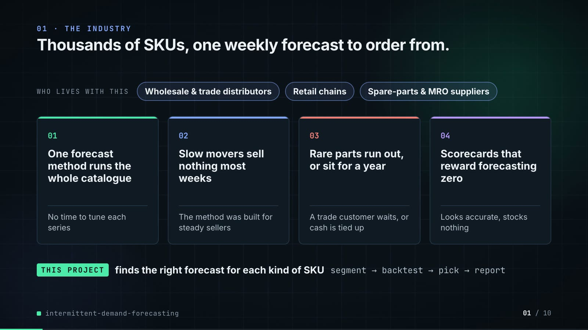

**On-screen text (verbatim)**

> 01 · THE INDUSTRY  
> Thousands of SKUs, one weekly forecast to order from.  
> WHO LIVES WITH THIS · Wholesale & trade distributors · Retail chains · Spare-parts & MRO suppliers  
> 01 One forecast method runs the whole catalogue — No time to tune each series  
> 02 Slow movers sell nothing most weeks — The method was built for steady sellers  
> 03 Rare parts run out, or sit for a year — A trade customer waits, or cash is tied up  
> 04 Scorecards that reward forecasting zero — Looks accurate, stocks nothing  
> THIS PROJECT finds the right forecast for each kind of SKU · segment → backtest → pick → report  

**Figures on this slide**

| ID | Shown | Source · key | Calculation | Check |
|---|---|---|---|---|
| F-01 | 3 industry chips | `author's framing` · - | - | manual |
| F-02 | 4 problem cards | `README 'The problem'` · README lines 14-28 | - | ✓ |

**Assumptions:** A-12

**Illustrative, not data:**

- The whole slide is context; no repo figures.

**To change this slide:** Edit the chips (#ctx-c1..3) and cards (#ctx-k1..4) in compositions/s01-context.html. (project folder `docs/demo/source`).

### Slide 02: This project  
*6.8-12.0 s · composition `compositions/s02-hook.html`*

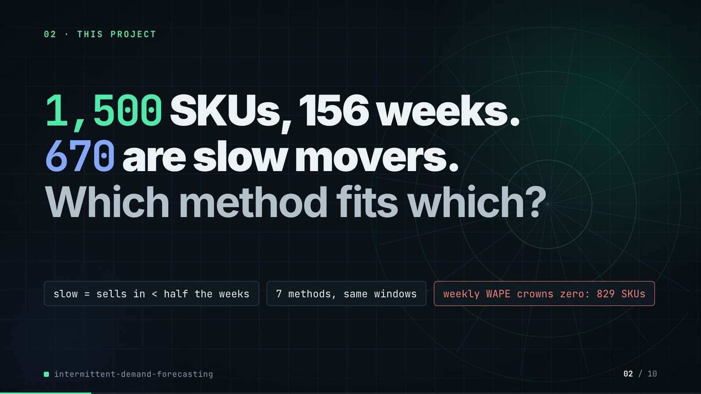

**On-screen text (verbatim)**

> 02 · THIS PROJECT  
> 1,500 SKUs, 156 weeks. 670 are slow movers. Which method fits which?  
> slow = sells in < half the weeks · 7 methods, same windows · weekly WAPE crowns zero: 829 SKUs  

**Figures on this slide**

| ID | Shown | Source · key | Calculation | Check |
|---|---|---|---|---|
| F-03 | 1,500 SKUs | `outputs/sku_segments.csv` · row count | - | ✓ |
| F-04 | 156 weeks / 1,500 × 156 wk | `outputs/run_log.txt (printed by cli.py from data/sales.parquet)` · '1500 SKUs, 156 weeks' | - | ✓ |
| F-05 | 670 are slow movers | `outputs/sku_segments.csv` · adi | count(adi > 2) = 670 | ✓ |
| F-06 | slow = sells in < half the weeks | `src/demand_segments/segments.py:26 (adi = len(h) / len(nz))` · ADI = observed weeks / weeks with a sale | ADI > 2 <=> sale weeks < half of observed weeks | ✓ |
| F-07 | 7 methods, same windows / Seven methods | `outputs/forecasts.parquet (model column)` · models minus ZeroForecast and LightGBM-history-only | 9 - 2 = 7 | ✓ |
| F-08 | weekly WAPE crowns zero: 829 SKUs | `outputs/segment_counts.csv; outputs/scores_by_segment.csv` · skus where segment in {intermittent, lumpy} | 397 + 432 = 829 | ✓ |
| F-09 | crowns zero / zero beats every model | `outputs/scores_by_segment.csv` · argmin(wape) per segment | segments whose best weekly WAPE is ZeroForecast = {intermittent, lumpy} | ✓ |

**Assumptions:** A-01, A-02, A-03

**Illustrative, not data:**

- Rings in the background are decoration.

**To change this slide:** Headline spans #hook-l1..l3 and chips #hook-f1..f3 in compositions/s02-hook.html. (project folder `docs/demo/source`).

### Slide 03: How it works (white chapter, slide A)  
*11.7-19.7 s · composition `compositions/explainer.html (CONFIG.blocks, CONFIG.groups, CONFIG.loop)`*

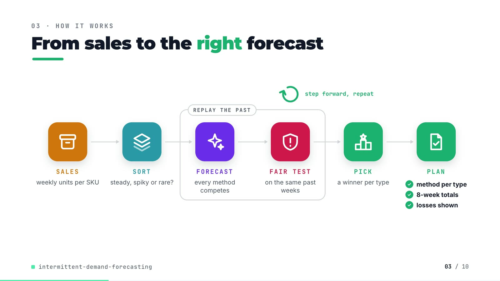

**On-screen text (verbatim)**

> 03 · HOW IT WORKS  
> From sales to the right forecast  
> SALES weekly units per SKU → SORT steady, spiky or rare? → [REPLAY THE PAST: FORECAST every method competes → FAIR TEST on the same past weeks] → PICK a winner per type → PLAN ✓ method per type ✓ 8-week totals ✓ losses shown  
> step forward, repeat (loop over the fair test)  

**Figures on this slide**

| ID | Shown | Source · key | Calculation | Check |
|---|---|---|---|---|
| F-10 | method per type · 8-week totals · losses shown | `outputs/champions.csv; outputs/scores_by_segment.csv (wape_8wk); outputs/lightgbm_vs_best_statistical.csv` · 4 champion rows; wape_8wk column; win share < 50% on intermittent | - | ✓ |
| F-11 | REPLAY THE PAST · step forward, repeat · refit ×6 | `src/demand_segments/backtest.py:29-31; forecast_stats.py:49-57` · origins(); cross_validation(step_size=HORIZON) | - | ✓ |

**Assumptions:** A-02, A-03, A-04

**Illustrative, not data:**

- Icons and colours are a visual language, not data.
- 'Type' is the plain-words name for a demand segment.

**To change this slide:** Edit CONFIG in compositions/explainer.html; badge truth is F-10. (project folder `docs/demo/source`).

### Slide 04: The key idea (white chapter, slide B)  
*19.7-26.7 s · composition `compositions/explainer.html (#ex-b ...)`*

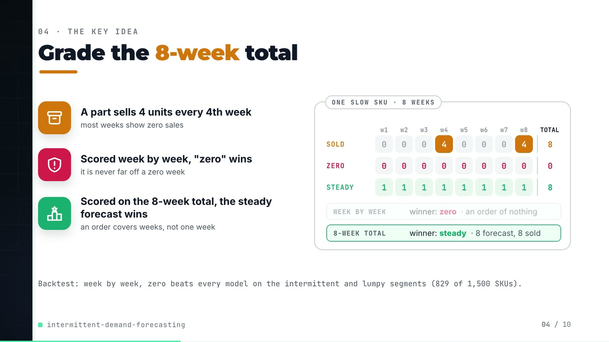

**On-screen text (verbatim)**

> 04 · THE KEY IDEA  
> Grade the 8-week total  
> A part sells 4 units every 4th week — most weeks show zero sales  
> Scored week by week, "zero" wins — it is never far off a zero week  
> Scored on the 8-week total, the steady forecast wins — an order covers weeks, not one week  
> ONE SLOW SKU · 8 WEEKS: SOLD 0 0 0 4 0 0 0 4 (total 8) · ZERO 0 ×8 (0) · STEADY 1 ×8 (8)  
> WEEK BY WEEK winner: zero · an order of nothing | 8-WEEK TOTAL winner: steady · 8 forecast, 8 sold  
> Backtest: week by week, zero beats every model on the intermittent and lumpy segments (829 of 1,500 SKUs).  

**Figures on this slide**

| ID | Shown | Source · key | Calculation | Check |
|---|---|---|---|---|
| F-08 | weekly WAPE crowns zero: 829 SKUs | `outputs/segment_counts.csv; outputs/scores_by_segment.csv` · skus where segment in {intermittent, lumpy} | 397 + 432 = 829 | ✓ |
| F-09 | crowns zero / zero beats every model | `outputs/scores_by_segment.csv` · argmin(wape) per segment | segments whose best weekly WAPE is ZeroForecast = {intermittent, lumpy} | ✓ |
| F-12 | SOLD 0 0 0 4 0 0 0 4 · ZERO · STEADY · winners | `tests/test_metrics.py:70-80 (test_eight_week_wape_stops_rewarding_the_zero_forecast)` · y = tile([0,0,0,4], 2) | weekly WAPE: steady 12/8 = 150% > zero 100%; 8-week WAPE: steady 0%, zero 100% | ✓ |

**Assumptions:** A-02, A-04

**Illustrative, not data:**

- The SOLD / ZERO / STEADY grid is the hand-worked case pinned in tests/test_metrics.py (F-12), not a real SKU.

**To change this slide:** Markup under #ex-b and the grid script in compositions/explainer.html; the footnote figures are F-08 and F-09. (project folder `docs/demo/source`).

### Slide 05: Architecture  
*26.4-42.4 s · composition `compositions/s03-architecture.html`*

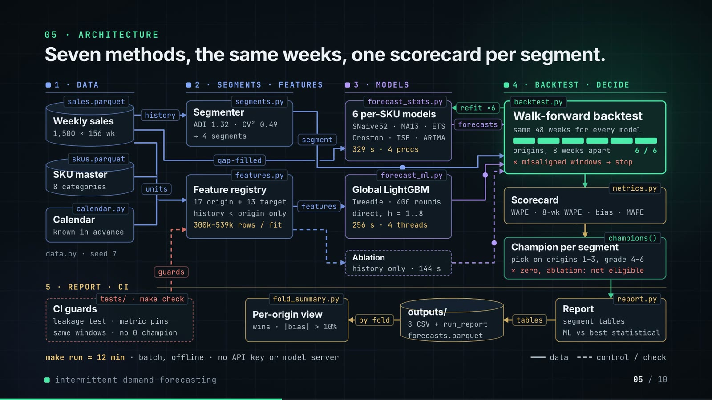

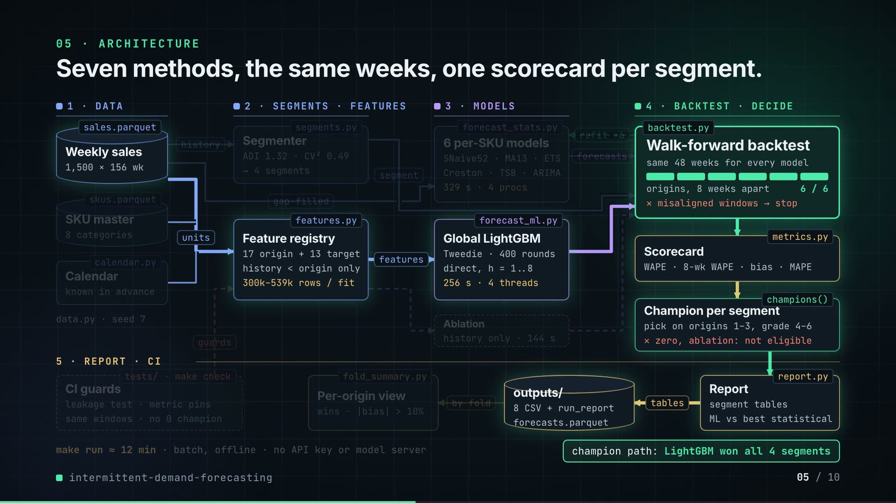

**On-screen text (verbatim)**

> 05 · ARCHITECTURE  
> Seven methods, the same weeks, one scorecard per segment.  
> 1 · DATA: sales.parquet Weekly sales (1,500 × 156 wk) · skus.parquet SKU master (8 categories) · calendar.py Calendar (known in advance) · data.py · seed 7  
> 2 · SEGMENTS · FEATURES: segments.py Segmenter (ADI 1.32 · CV² 0.49 → 4 segments) · features.py Feature registry (17 origin + 13 target · history < origin only · 300k–539k rows / fit)  
> 3 · MODELS: forecast_stats.py 6 per-SKU models (SNaive52 · MA13 · ETS · Croston · TSB · ARIMA · 329 s · 4 procs) · forecast_ml.py Global LightGBM (Tweedie · 400 rounds · direct, h = 1..8 · 256 s · 4 threads) · Ablation (history only · 144 s)  
> 4 · BACKTEST · DECIDE: backtest.py Walk-forward backtest (same 48 weeks for every model · origins, 8 weeks apart 6 / 6 · ✕ misaligned windows → stop) → metrics.py Scorecard (WAPE · 8-wk WAPE · bias · MAPE) → champions() Champion per segment (pick on origins 1–3, grade 4–6 · ✕ zero, ablation: not eligible)  
> 5 · REPORT · CI: report.py Report (segment tables · ML vs best statistical) → outputs/ (8 CSV + run_report · forecasts.parquet) → fold_summary.py Per-origin view (wins · |bias| > 10%) · tests/ · make check CI guards (leakage test · metric pins · same windows · no 0 champion)  
> Edge labels: history · units · gap-filled · features · segment · forecasts · refit ×6 · tables · by fold · guards  
> make run ≈ 12 min · batch, offline · no API key or model server · legend: data / control-check  
> champion path: LightGBM won all 4 segments  

**Figures on this slide**

| ID | Shown | Source · key | Calculation | Check |
|---|---|---|---|---|
| F-03 | 1,500 SKUs | `outputs/sku_segments.csv` · row count | - | ✓ |
| F-04 | 156 weeks / 1,500 × 156 wk | `outputs/run_log.txt (printed by cli.py from data/sales.parquet)` · '1500 SKUs, 156 weeks' | - | ✓ |
| F-07 | 7 methods, same windows / Seven methods | `outputs/forecasts.parquet (model column)` · models minus ZeroForecast and LightGBM-history-only | 9 - 2 = 7 | ✓ |
| F-11 | REPLAY THE PAST · step forward, repeat · refit ×6 | `src/demand_segments/backtest.py:29-31; forecast_stats.py:49-57` · origins(); cross_validation(step_size=HORIZON) | - | ✓ |
| F-14 | sales.parquet, skus.parquet, calendar.py, data.py, segments.py, features.py, forecast_stats.py, forecast_ml.py, backtest.py, metrics.py, champions(), report.py, fold_summary.py, tests/ · make check | `src/demand_segments/, scripts/, tests/, Makefile` · files + defs | - | ✓ |
| F-16 | 8 categories | `src/demand_segments/data.py:20-29 (CATEGORIES)` · dict entries | - | ✓ |
| F-17 | data.py · seed 7 | `src/demand_segments/data.py:39` · seed: int = 7 | - | ✓ |
| F-18 | ADI 1.32 · CV² 0.49 | `src/demand_segments/segments.py:14-15` · ADI_CUT, CV2_CUT | - | ✓ |
| F-19 | 17 origin + 13 target | `src/demand_segments/features.py (ORIGIN_FEATURES, TARGET_FEATURES) via demo assets/forecast_sheet.json arch` · len(ORIGIN_FEATURES), len(TARGET_FEATURES) | - | ✓ |
| F-20 | 300k–539k rows / fit | `features.training_frame(panel, origin) via demo assets/forecast_sheet.json arch` · train_rows_first_origin = 299,648; train_rows_last_origin = 539,390 | rounded to thousands | ✓ |
| F-21 | SNaive52 · MA13 · ETS · Croston · TSB · ARIMA | `src/demand_segments/forecast_stats.py:25-33` · models() | - | ✓ |
| F-22 | 329 s · 4 procs | `outputs/run_report.md; Makefile:8` · 'statistical models: 329'; --jobs 4 | - | ✓ |
| F-23 | Tweedie · 400 rounds · direct, h = 1..8 · 256 s · 4 threads | `src/demand_segments/forecast_ml.py:14, :25, :27; features.py:21; outputs/run_report.md` · objective, num_threads, ROUNDS, HORIZON, 'LightGBM: 256' | - | ✓ |
| F-24 | Ablation · history only · 144 s | `outputs/run_report.md` · 'LightGBM-history-only: 144' | - | ✓ |
| F-25 | same 48 weeks for every model · origins, 8 weeks apart · 6 / 6 | `outputs/forecasts.parquet` · distinct weeks; 6 folds | 6 × 8 = 48 | ✓ |
| F-26 | ✕ misaligned windows → stop | `src/demand_segments/backtest.py:56-59` · RuntimeError | - | ✓ |
| F-27 | WAPE · 8-wk WAPE · bias · MAPE | `src/demand_segments/metrics.py` · wape, window_wape, bias, mape | - | ✓ |
| F-28 | pick on origins 1–3, grade 4–6 | `src/demand_segments/report.py:30; backtest.py:109` · n_select = n_windows // 2 = 3 | - | ✓ |
| F-29 | ✕ zero, ablation: not eligible | `src/demand_segments/backtest.py:108; tests/test_backtest.py:41` · isin([ZERO, ML_HISTORY_ONLY]) | - | ✓ |
| F-30 | 8 CSV + run_report | `src/demand_segments/report.py:41-48` · .to_csv calls | - | ✓ |
| F-31 | wins · \|bias\| > 10% | `scripts/fold_summary.py` · origins_with_abs_bias_over_10pct | - | ✓ |
| F-32 | CI guards · leakage test · metric pins · same windows · no 0 champion | `tests/*.py; .github/workflows/ci.yml; Makefile check` · test names | - | ✓ |
| F-33 | make run ≈ 12 min / ~12 min | `outputs/run_report.md 'Run time (seconds)'` · 329 + 256 + 144 = 729 s | 729 / 60 = 12.2 min | ✓ |
| F-34 | batch, offline · no API key or model server | `README 'Running it'` · 'Nothing needs an API key or a model server' | - | ✓ |
| F-35 | champion path: LightGBM won all 4 segments | `outputs/champions.csv` · champion | count(champion == LightGBM) | ✓ |
| F-36 | refit ×6 | `src/demand_segments/backtest.py:68-71 (fit per origin); forecast_stats.py:49-57 (cross_validation n_windows)` · for fold, origin in enumerate(starts) | - | ✓ |

**Assumptions:** A-01, A-02, A-03, A-04, A-05, A-06, A-07, A-08, A-09

**Illustrative, not data:**

- Packets moving along the wires show execution order, not data volumes.
- The origin bar fills 1..6 in animation time, not real time.
- The 'champion path' highlight marks the LightGBM route through the pipeline; the other boxes are dimmed, not removed.

**To change this slide:** Node boxes (#n-*) and the W wires array (points, labels, execution order, crit flag) in compositions/s03-architecture.html. (project folder `docs/demo/source`).

### Slide 06: The system running  
*42.0-56.6 s · composition `compositions/s04-routes.html (RUN block injected by tools/inject_sheet.py)`*

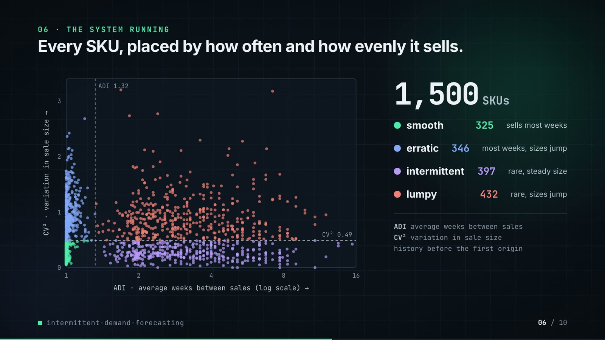

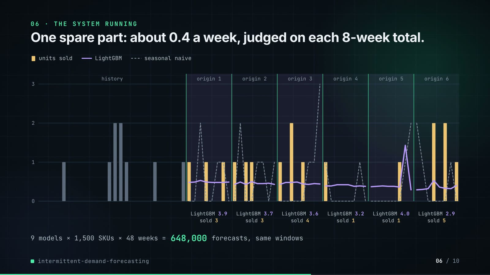

**On-screen text (verbatim)**

> 06 · THE SYSTEM RUNNING  
> Every SKU, placed by how often and how evenly it sells.  
> ADI / CV² scatter with cut lines ADI 1.32, CV² 0.49 · 1,500 SKUs · smooth 325 sells most weeks · erratic 346 most weeks, sizes jump · intermittent 397 rare, steady size · lumpy 432 rare, sizes jump  
> ADI average weeks between sales · CV² variation in sale size · history before the first origin  
> One spare part: about 0.4 a week, judged on each 8-week total.  
> units sold · LightGBM · seasonal naive; history + origin 1..6; LightGBM 3.9 / sold 3 · 3.7 / 3 · 3.6 / 4 · 3.2 / 1 · 4.0 / 1 · 2.9 / 5  
> 9 models × 1,500 SKUs × 48 weeks = 648,000 forecasts, same windows  

**Figures on this slide**

| ID | Shown | Source · key | Calculation | Check |
|---|---|---|---|---|
| F-03 | 1,500 SKUs | `outputs/sku_segments.csv` · row count | - | ✓ |
| F-18 | ADI 1.32 · CV² 0.49 | `src/demand_segments/segments.py:14-15` · ADI_CUT, CV2_CUT | - | ✓ |
| F-25 | same 48 weeks for every model · origins, 8 weeks apart · 6 / 6 | `outputs/forecasts.parquet` · distinct weeks; 6 folds | 6 × 8 = 48 | ✓ |
| F-37 | 325 / 346 / 397 / 432 | `outputs/segment_counts.csv` · skus | - | ✓ |
| F-38 | 1,500 dots on the ADI / CV² plane | `outputs/sku_segments.csv; RUN block in compositions/s04-routes.html` · adi, cv2, segment (rounded to 3 decimals) | - | ✓ |
| F-39 | 3.9/3 · 3.7/3 · 3.6/4 · 3.2/1 · 4.0/1 · 2.9/5 | `outputs/forecasts.parquet` · sku_id = SKU00191, model = LightGBM, sum(yhat), sum(y) per fold | sums per fold, forecast rounded to 0.1 | ✓ |
| F-40 | about 0.4 a week | `outputs/forecasts.parquet` · SKU00191, LightGBM, mean(yhat) over 48 weeks = 0.44 | - | ✓ |
| F-41 | 9 models × 1,500 SKUs × 48 weeks = 648,000 forecasts | `outputs/forecasts.parquet` · row count | 9 × 1,500 × 48 | ✓ |
| F-42 | One spare part | `outputs/sku_segments.csv; data/skus.parquet` · SKU00191 | - | ✓ |

**Assumptions:** A-02, A-03, A-08

**Illustrative, not data:**

- The scatter is redrawn in SVG from outputs/sku_segments.csv (the repo saves no plot); CV² axis runs to 3.4 (max in data 3.20).
- The plain-words segment descriptions are the Syntetos-Boylan quadrant meanings.

**To change this slide:** Re-run tools/export_forecast_sheet.py + tools/inject_sheet.py --block RUN; layout in compositions/s04-routes.html. (project folder `docs/demo/source`).

### Slide 07: End-user value (white)  
*56.3-69.3 s · composition `compositions/value.html (SHEET block injected by tools/inject_sheet.py)`*

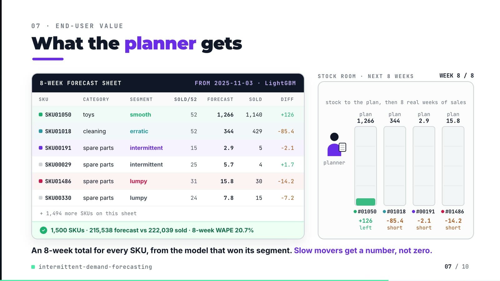

**On-screen text (verbatim)**

> 07 · END-USER VALUE  
> What the planner gets  
> 8-WEEK FORECAST SHEET · FROM 2025-11-03 · LightGBM — columns SKU, CATEGORY, SEGMENT, SOLD/52, FORECAST, SOLD, DIFF  
> SKU01050 toys smooth 52 1,266 1,140 +126  
> SKU01018 cleaning erratic 52 344 429 −85.4  
> SKU00191 spare parts intermittent 15 2.9 5 −2.1  
> SKU00029 spare parts intermittent 25 5.7 4 +1.7  
> SKU01486 spare parts lumpy 31 15.8 30 −14.2  
> SKU00330 spare parts lumpy 24 7.8 15 −7.2  
> + 1,494 more SKUs on this sheet · ✓ 1,500 SKUs · 215,538 forecast vs 222,039 sold · 8-week WAPE 20.7%  
> STOCK ROOM · NEXT 8 WEEKS · stock to the plan, then 8 real weeks of sales · planner · plan 1,266 / 344 / 2.9 / 15.8 · WEEK 8 / 8 · +126 left · −85.4 short · −2.1 short · −14.2 short  
> An 8-week total for every SKU, from the model that won its segment. Slow movers get a number, not zero.  

**Figures on this slide**

| ID | Shown | Source · key | Calculation | Check |
|---|---|---|---|---|
| F-03 | 1,500 SKUs | `outputs/sku_segments.csv` · row count | - | ✓ |
| F-43 | SKU01050, SKU01018, SKU00191, SKU00029, SKU01486, SKU00330 | `outputs/forecasts.parquet (fold 6, LightGBM); outputs/sku_segments.csv; data/skus.parquet; data/sales.parquet; SHEET block in compositions/value.html` · per-SKU sums | recomputed from the repo files, compared to the injected SHEET | ✓ |
| F-44 | + 1,494 more SKUs on this sheet | `F-03` · 1,500 - 6 rows | 1,500 - 6 = 1,494 | ✓ |
| F-45 | 215,538 forecast vs 222,039 sold | `outputs/forecasts.parquet` · fold 6, LightGBM: sum(yhat), sum(y) | - | ✓ |
| F-46 | 8-week WAPE 20.7% | `outputs/forecasts.parquet` · fold 6, LightGBM | sum \|8-wk forecast - 8-wk sold\| / sum 8-wk sold over SKUs (metrics.window_wape) | ✓ |
| F-47 | FROM 2025-11-03 · LightGBM | `outputs/forecasts.parquet` · first week of fold 6 | - | ✓ |

**Assumptions:** A-06, A-10, A-11

**Illustrative, not data:**

- Planner figure, boxes and bays are drawings; bay heights are scaled per bay.
- The bays drain by each week's real units sold; this is forecast minus actual, not a service-level or inventory simulation (A-10).
- 'Slow movers get a number, not zero' describes the LightGBM forecasts shown; it is framing, not a measured result.

**To change this slide:** Re-run tools/export_forecast_sheet.py, then tools/inject_sheet.py --block SHEET; layout and scene in compositions/value.html. (project folder `docs/demo/source`).

### Slide 08: Results  
*69.0-77.8 s · composition `compositions/s05-results.html (stats array)`*

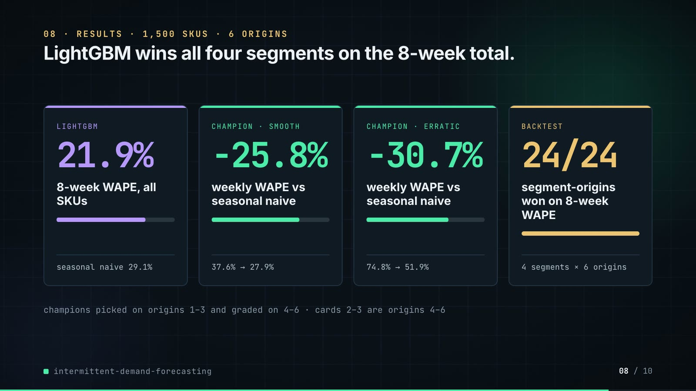

**On-screen text (verbatim)**

> 08 · RESULTS · 1,500 SKUS · 6 ORIGINS  
> LightGBM wins all four segments on the 8-week total.  
> LIGHTGBM 21.9% 8-week WAPE, all SKUs · seasonal naive 29.1%  
> CHAMPION · SMOOTH −25.8% weekly WAPE vs seasonal naive · 37.6% → 27.9%  
> CHAMPION · ERRATIC −30.7% weekly WAPE vs seasonal naive · 74.8% → 51.9%  
> BACKTEST 24/24 segment-origins won on 8-week WAPE · 4 segments × 6 origins  
> champions picked on origins 1–3 and graded on 4–6 · cards 2–3 are origins 4–6  

**Figures on this slide**

| ID | Shown | Source · key | Calculation | Check |
|---|---|---|---|---|
| F-03 | 1,500 SKUs | `outputs/sku_segments.csv` · row count | - | ✓ |
| F-28 | pick on origins 1–3, grade 4–6 | `src/demand_segments/report.py:30; backtest.py:109` · n_select = n_windows // 2 = 3 | - | ✓ |
| F-50 | 21.9% | `outputs/scores_by_segment.csv` · segment=all, model=LightGBM, wape_8wk | x 100 | ✓ |
| F-51 | seasonal naive 29.1% | `outputs/scores_by_segment.csv` · segment=all, model=SeasonalNaive, wape_8wk | x 100 | ✓ |
| F-52 | -25.8% | `outputs/champions.csv` · segment=smooth, wape_reduction_vs_seasonal_naive | -(x 100) | ✓ |
| F-53 | 37.6% → 27.9% | `outputs/champions.csv` · seasonal_naive_wape, champion_wape | - | ✓ |
| F-54 | -30.7% | `outputs/champions.csv` · segment=erratic, wape_reduction_vs_seasonal_naive | -(x 100) | ✓ |
| F-55 | 74.8% → 51.9% | `outputs/champions.csv` · seasonal_naive_wape, champion_wape | - | ✓ |
| F-56 | 24/24 · 4 segments × 6 origins | `outputs/fold_summary.csv` · sum(origins_won_on_wape_8wk), sum(origins) | - | ✓ |
| F-57 | LightGBM wins all four segments on the 8-week total. | `outputs/scores_by_segment.csv` · argmin(wape_8wk) excluding ZeroForecast and the ablation | - | ✓ |

**Assumptions:** A-04, A-05, A-06, A-11

**Illustrative, not data:**

- Mini bars under each number are drawn to the same ratio (after / before; 24/24 = full).

**To change this slide:** The stats array and card text in compositions/s05-results.html. (project folder `docs/demo/source`).

### Slide 09: What didn't win  
*77.4-84.4 s · composition `compositions/s06-twist.html`*

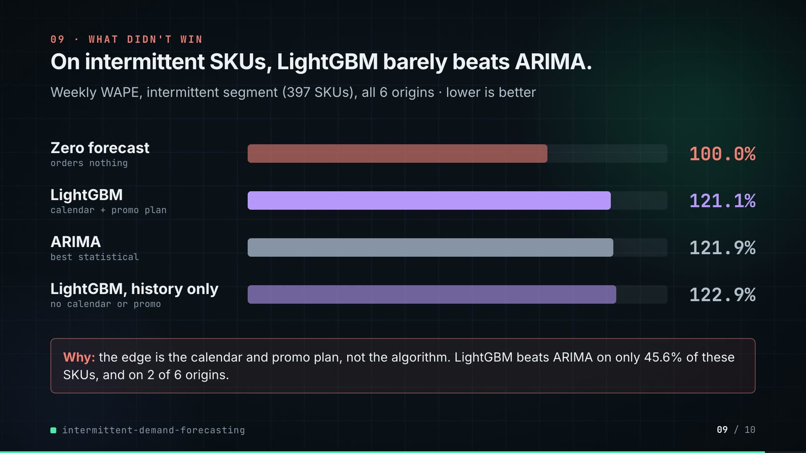

**On-screen text (verbatim)**

> 09 · WHAT DIDN'T WIN  
> On intermittent SKUs, LightGBM barely beats ARIMA.  
> Weekly WAPE, intermittent segment (397 SKUs), all 6 origins · lower is better  
> Zero forecast (orders nothing) 100.0% · LightGBM (calendar + promo plan) 121.1% · ARIMA (best statistical) 121.9% · LightGBM, history only (no calendar or promo) 122.9%  
> Why: the edge is the calendar and promo plan, not the algorithm. LightGBM beats ARIMA on only 45.6% of these SKUs, and on 2 of 6 origins.  

**Figures on this slide**

| ID | Shown | Source · key | Calculation | Check |
|---|---|---|---|---|
| F-58 | 100.0% | `outputs/scores_by_segment.csv` · segment=intermittent, model=ZeroForecast, wape | x 100 | ✓ |
| F-59 | 121.1% | `outputs/scores_by_segment.csv` · segment=intermittent, model=LightGBM, wape | x 100 | ✓ |
| F-60 | 121.9% | `outputs/scores_by_segment.csv; outputs/lightgbm_vs_best_statistical.csv` · segment=intermittent, model=AutoARIMA, wape; best_statistical = AutoARIMA | x 100 | ✓ |
| F-61 | 122.9% | `outputs/scores_by_segment.csv` · segment=intermittent, model=LightGBM-history-only, wape | x 100 | ✓ |
| F-62 | 397 SKUs | `outputs/segment_counts.csv` · segment=intermittent | - | ✓ |
| F-63 | 45.6% | `outputs/lightgbm_vs_best_statistical.csv` · segment=intermittent, lightgbm_sku_win_share | x 100 | ✓ |
| F-64 | 2 of 6 origins | `outputs/fold_summary.csv` · segment=intermittent, origins_won_on_wape / origins | - | ✓ |
| F-65 | the edge is the calendar and promo plan, not the algorithm | `outputs/scores_by_segment.csv` · intermittent: LightGBM-history-only 122.9% > AutoARIMA 121.9% > LightGBM 121.1% | - | ✓ |

**Assumptions:** A-05, A-07, A-11

**Illustrative, not data:**

- Bar lengths: 1,000 px track = 140% weekly WAPE.

**To change this slide:** Rows #twist-r1..r4 (bar widths are inline styles) in compositions/s06-twist.html. (project folder `docs/demo/source`).

### Slide 10: End card  
*84.0-88.4 s · composition `compositions/s07-end.html`*

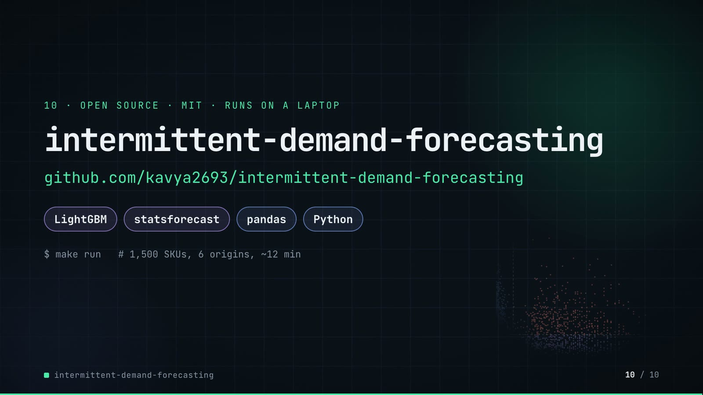

**On-screen text (verbatim)**

> 10 · OPEN SOURCE · MIT · RUNS ON A LAPTOP  
> intermittent-demand-forecasting  
> github.com/kavya2693/intermittent-demand-forecasting  
> LightGBM · statsforecast · pandas · Python  
> $ make run   # 1,500 SKUs, 6 origins, ~12 min  

**Figures on this slide**

| ID | Shown | Source · key | Calculation | Check |
|---|---|---|---|---|
| F-33 | make run ≈ 12 min / ~12 min | `outputs/run_report.md 'Run time (seconds)'` · 329 + 256 + 144 = 729 s | 729 / 60 = 12.2 min | ✓ |
| F-66 | MIT | `LICENSE line 1` · - | - | ✓ |
| F-67 | $ make run   # 1,500 SKUs, 6 origins, ~12 min | `Makefile:7-9; README 'Running it'` · run target | - | ✓ |
| F-68 | LightGBM · statsforecast · pandas · Python | `pyproject.toml dependencies` · lightgbm, statsforecast, pandas | - | ✓ |

**Assumptions:** A-09, A-11

**Illustrative, not data:**

- Faded scatter in the background is outputs/sku_segments.csv drawn by tools/make_end_scatter.py.

**To change this slide:** Text in compositions/s07-end.html. (project folder `docs/demo/source`).

## 5. Change-impact matrix

| Input / assumption | Affected figures | Affected slides | Files to edit | Commands to re-run |
|---|---|---|---|---|
| A-01: All data is synthetic, produced by a seeded generator sized to the production problem: 1,500 SKUs, 156 weekly periods, 8 categories, B2B and B2C channels, seed 7 | all figures | 01, 02, 03, 04, 05, 06, 07, 08, 09, 10 | `src/demand_segments/data.py (GeneratorConfig, CATEGORIES, PATTERN_MIX)` | `make data; make run; export_forecast_sheet.py + inject_sheet.py` |
| A-02: Segments use the Syntetos-Boylan cut-offs ADI 1 | F-05, F-06, F-08, F-09, F-18, F-37, F-38, F-62 | 02, 04, 05, 06, 09 | `src/demand_segments/segments.py:14-15` | `make run; export_forecast_sheet.py + inject_sheet.py` |
| A-03: Walk-forward backtest: six origins, eight weeks apart, each forecasting the next eight weeks (48 test weeks), the same windows for every model | F-07, F-11, F-25, F-36, F-39, F-41, F-56, F-64 | 02, 03, 05, 06, 08, 09 | `src/demand_segments/cli.py:18; src/demand_segments/features.py:21` | `make run; export_forecast_sheet.py + inject_sheet.py` |
| A-04: Each segment's champion is picked on eight-week WAPE over origins 1-3 and graded on origins 4-6; the zero forecast and the history-only ablation are never eligible | F-10, F-28, F-29, F-35, F-52, F-53, F-54, F-55 | 03, 05, 08 | `src/demand_segments/backtest.py:100-130; src/demand_segments/report.py:30` | `make run` |
| A-05: ETS and ARIMA are fitted without a 52-week season (season_length=1); only seasonal naive and LightGBM carry the yearly pattern, so the statistical side is weaker on seasonal SKUs than a tuned seasonal model would be | F-21, F-53, F-55, F-58, F-59, F-60, F-61, F-63, F-64 | 05, 08, 09 | `src/demand_segments/forecast_stats.py:22-33` | `make run` |
| A-06: LightGBM settings: Tweedie objective (variance power 1 | F-23, F-50, F-52, F-54, F-56, F-57, F-59 | 05, 08, 09 | `src/demand_segments/forecast_ml.py:11-27` | `make run; export_forecast_sheet.py + inject_sheet.py` |
| A-07: LightGBM may read the calendar, the promotion plan and the price list for the target week (11 'known-future' features), because a planner has them in advance | F-24, F-61, F-65 | 05, 09 | `src/demand_segments/forecast_ml.py:30-42; src/demand_segments/features.py (TARGET_FEATURES)` | `make run` |
| A-08: Feed-gap weeks are filled with a trailing 8-week mean for the statistical models' inputs only; every score uses the raw actuals, and missing actual weeks are skipped, never scored as zero | F-41, F-45, F-46 | 06, 07 | `src/demand_segments/forecast_stats.py:37-46` | `make run` |
| A-09: Run times are wall-clock seconds from one make run on the author's laptop with --jobs 4 (statistical models) and 4 LightGBM threads; they change with the machine and its load | F-22, F-23, F-24, F-33, F-67 | 05, 10 | `Makefile:8` | `make run` |
| A-10: Slide 07 shows the LAST backtest origin (2025-11-03, weeks to 2025-12-22) as if it were the planner's sheet, with what actually sold next to it | F-43, F-44, F-45, F-46, F-47 | 07 | `tools/export_forecast_sheet.py (pick rules)` | `export_forecast_sheet.py + inject_sheet.py; hyperframes render` |
| A-11: Video rounding: percentages to 1 decimal, units and counts to whole numbers with thousands separators, 8-week totals under 100 units to 1 decimal; '300k-539k', '≈ 12 min' and 'about 0 | F-20, F-33, F-40, F-45, F-46, F-50, F-51, F-52, F-53, F-54, F-55, F-58, F-59, F-60, F-61, F-63, F-67 | 05, 06, 07, 08, 09, 10 | `the composition file named on each slide` | `hyperframes render` |
| A-12: Slide 01 (industries, everyday problems) is general demand-planning knowledge used as context | F-01, F-02 | 01 | `compositions/s01-context.html` | `hyperframes render` |

## 6. Known differences and caveats

- All results are on generated data (A-01): they show the method behaving as expected on realistic patterns, not a measured business impact (README 'Known limitations').
- Forecasts are point forecasts only; slide 07's 'left / short' is forecast minus actual over 8 weeks, not a fill-rate or stock simulation (A-10).
- ETS and ARIMA run without a yearly season (A-05), which makes the statistical side weaker on seasonal SKUs than a tuned seasonal model.
- LightGBM under-forecasts lumpy SKUs (bias -8.9% over all origins, -15.7% at its worst origin); the video does not show this, the README does.
- Weekly WAPE above 100% on the intermittent and lumpy segments is expected: a zero forecast scores exactly 100%, which is why the scorecard uses the 8-week total.
- Slide 07 rows are median-error SKUs per segment chosen by the demo export script, not by the repo.
- Run times (A-09) are one run on the author's laptop.
- Slide 01 statements are general demand-planning knowledge (A-12).

## Appendix: environment

- Commit: `3616b6c2747b6be20b0c56b6345c4954391b22ac`
- Python: 3.11.7
- lightgbm 4.7.0
- statsforecast 2.0.1
- pandas 3.0.6
- numpy 2.4.6
- Profile / seeds: data_seed=7, lightgbm_seed=7, skus=1500, weeks=156, origins=6, horizon_weeks=8
- Run time: outputs/run_report.md: statistical models 329 s + LightGBM 256 s + history-only ablation 144 s = 729 s (about 12 min) for make run (--jobs 4) on the author's laptop
